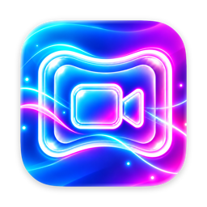
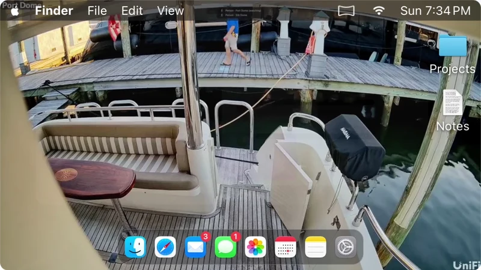
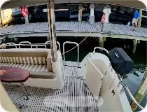
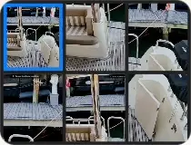
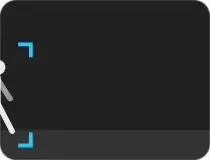
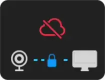
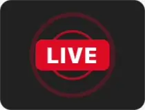
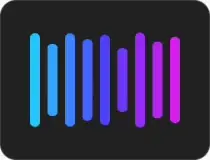

  

<h1 align="center">PanoPaper</h1>

  Your UniFi Protect and IP cameras, live as your Mac's desktop wallpaper. 
  <a href="https://panopaper.app">panopaper.app</a> · <a href="https://panopaper.app/downloading">Download</a> · <a href="https://www.reddit.com/r/panopaper/">r/panopaper</a>

<picture>
  <source media="(prefers-color-scheme: dark)" srcset="assets/welcome-dark.webp">
  
</picture>

PanoPaper is a menu bar app for macOS 15 and later. It puts a camera's live video on your desktop as the wallpaper, under your windows and desktop icons: one camera on every display, or a different one on every Space. While you work, the video steps back. Clear the desktop and it's there in full, or go Full Screen whenever you like.

It works with UniFi Protect NVRs and with IP cameras that speak ONVIF or RTSP, no NVR needed. Video goes straight from your cameras to your Mac, on your own network.

## What it does

<table>
  <tr>
    <td width="50%"><picture><source media="(prefers-color-scheme: dark)" srcset="assets/card-wallpaper-dark.webp"></picture> <b>Live video wallpaper</b> A camera on every display, or on every desktop.</td>
    <td width="50%"><picture><source media="(prefers-color-scheme: dark)" srcset="assets/card-wall-dark.webp"></picture> <b>Video-Wall(paper)</b> All your cameras in one grid, in Full Screen too.</td>
  </tr>
  <tr>
    <td><picture><source media="(prefers-color-scheme: dark)" srcset="assets/card-detect-dark.webp"></picture> <b>Detects people and animals</b> A quiet heads-up when someone comes by.</td>
    <td><picture><source media="(prefers-color-scheme: dark)" srcset="assets/card-private-dark.webp"></picture> <b>Private</b> Video goes straight from your cameras to your Mac. No cloud.</td>
  </tr>
  <tr>
    <td><picture><source media="(prefers-color-scheme: dark)" srcset="assets/card-live-dark.webp"></picture> <b>Broadcast to YouTube and Facebook</b> Share the view with one click.</td>
    <td><picture><source media="(prefers-color-scheme: dark)" srcset="assets/card-siri-dark.webp"></picture> <b>Works with Siri and Shortcuts</b> Ask Siri for a camera, or let a shortcut switch it.</td>
  </tr>
</table>

Every feature is free. For the first seven days your cameras show without the "UNLICENSED" stamp across them; PanoPaper Pro removes it for good. Plans at [panopaper.app](https://panopaper.app/#pricing).

## Get it

- **Download:** [panopaper.app/downloading](https://panopaper.app/downloading). PanoPaper keeps itself up to date.
- **Help:** [panopaper.app/docs](https://panopaper.app/docs/)
- **News and questions:** [r/panopaper](https://www.reddit.com/r/panopaper/)

## About this repository

This repository holds PanoPaper's releases: the files the website's Download button and the app's built-in updater fetch. The app's source code is not public.
